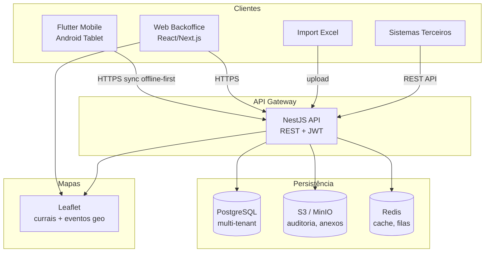
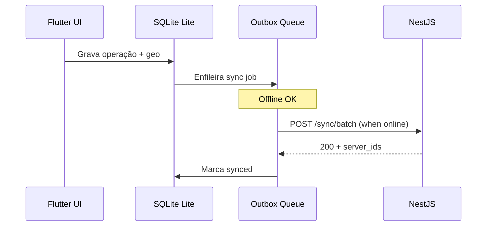

# Fase 3 — Arquitetura do RFeed Lite

Proposta de arquitetura para o novo produto, desacoplado do RFeed/CG Pec.

---

## 3.1 Diagrama de alto nível



---

## 3.2 Stack tecnológica

| Camada | Tecnologia | Justificativa |
|--------|------------|---------------|
| **Mobile** | Flutter 3.x | Reaproveitar 60%+ do RFeed tablet |
| **Backend** | NestJS (TypeScript) | Modular, OpenAPI, multi-tenant, equipe JS |
| **Banco** | PostgreSQL 15+ | SaaS + on-premise, JSONB, geo |
| **Cache/Fila** | Redis + BullMQ | Sync retry, jobs import Excel |
| **Storage** | S3 / MinIO | Audit logs, exports, anexos |
| **Web** | Next.js 14+ ou React SPA | Backoffice, import, dashboards |
| **Mapas** | Leaflet + OpenStreetMap | Currais, eventos geo (já usado no ecossistema) |
| **Auth** | JWT (access + refresh) | Mobile offline + web |
| **Multi-tenant** | `tenant_id` + RLS PostgreSQL | Isolamento por empresa |

**Por que não Delphi Horse no Lite?** Horse está acoplado ao Firebird/CG Pec. Reescrever controllers para Postgres seria reimplementar tudo. NestJS oferece ecossistema SaaS nativo.

**Por que não evoluir next-api existente?** Pasta ausente no repo; referências indicam projeto incompleto/espelho BI. Greenfield NestJS com contratos inspirados no Horse.

---

## 3.3 Multi-tenancy

### Estratégia: shared database, shared schema

```sql
-- Todas as tabelas operacionais
tenant_id UUID NOT NULL REFERENCES tenant(id)

-- Row Level Security (PostgreSQL)
CREATE POLICY tenant_isolation ON curral
  USING (tenant_id = current_setting('app.tenant_id')::uuid);
```

### Contexto de tenant

1. Login → JWT contém `tenant_id`, `user_id`, `roles`
2. NestJS middleware extrai tenant do JWT
3. `SET app.tenant_id = '...'` por request (connection pool)
4. Mobile: tenant fixo na config + token refresh

### Hierarquia

```
Tenant (empresa)
  └── Fazenda(s)
        └── Curral(is)
        └── Dieta(s)
        └── Usuário(s)
        └── Equipamento(s)
```

---

## 3.4 Modos de operação

| Modo | Balança | RFID | Entrada manual | Lite MVP |
|------|---------|------|----------------|----------|
| Manual total | ✗ | ✗ | ✓ teclado | **Sim** |
| Balança only | ✓ TCP | ✗ | ✓ fallback | Sim |
| RFID only | ✗ | ✓ TCP | ✓ seleção lista | Sim |
| Automatizado | ✓ | ✓ | ✓ fallback | Sim |

Config por dispositivo (`device_profile`):

```json
{
  "scale_enabled": true,
  "scale_host": "192.168.1.50",
  "scale_port": 4001,
  "scale_model": "topcom",
  "rfid_enabled": false,
  "manual_fallback": true
}
```

---

## 3.5 Offline-first (mobile)



### Princípios (herdados do RFeed)

1. **Write local first** — nunca bloquear operador por rede
2. **Outbox pattern** — `sync_status: pending | synced | error`
3. **Idempotency** — header `X-Idempotency-Key: {local_uuid}`
4. **Conflict resolution** — server wins para cadastros; append para fornecimento acumulativo
5. **Bootstrap** — download cadastros + previsão do dia no sync

---

## 3.6 Camadas NestJS

```
backend/src/
├── main.ts
├── app.module.ts
├── common/
│   ├── guards/          # JwtAuthGuard, TenantGuard, RolesGuard
│   ├── interceptors/    # Logging, transform
│   └── decorators/      # @TenantId(), @CurrentUser()
├── config/              # Env, database, S3
├── modules/
│   ├── auth/
│   ├── tenant/
│   ├── usuario/
│   ├── fazenda/
│   ├── curral/
│   ├── dieta/
│   ├── previsao/
│   ├── fabricacao/
│   ├── fornecimento/
│   ├── evento-geo/
│   ├── equipamento/
│   ├── sync/            # Batch upload/download
│   ├── import/          # Excel parser
│   └── dashboard/
└── database/
    ├── migrations/
    └── seeds/
```

---

## 3.7 Deploy

### SaaS

```
┌─────────────────────────────────────┐
│  Cloud (AWS/Azure/Hostinger)        │
│  ├── NestJS (Docker/K8s)            │
│  ├── PostgreSQL (RDS/managed)       │
│  ├── Redis                          │
│  ├── S3                               │
│  └── CDN → Web backoffice           │
└─────────────────────────────────────┘
         ↑ HTTPS
    Tablets + Browsers
```

### On-premise

```
┌─────────────────────────────────────┐
│  Servidor na fazenda / escritório   │
│  ├── docker-compose.yml             │
│  │   ├── api (NestJS)               │
│  │   ├── postgres                   │
│  │   ├── minio (S3 compat)          │
│  │   └── redis                      │
│  └── nginx reverse proxy :443       │
└─────────────────────────────────────┘
```

Mesma imagem Docker; diferença = config/env.

---

## 3.8 Segurança

| Aspecto | Implementação |
|---------|---------------|
| Auth | JWT RS256, refresh token rotation |
| API externa | API keys por tenant (integrações ERP) |
| Senhas | bcrypt (nunca em SQLite local) |
| RLS | PostgreSQL tenant isolation |
| Audit | `audit_log` + S3 dumps (como FornecimentoAudit) |
| HTTPS | Obrigatório (exceto LAN on-premise dev) |

---

## 3.9 Comparativo: evoluir RFeed vs greenfield Lite

| Critério | Evoluir RFeed | Greenfield Lite |
|----------|---------------|-----------------|
| Risco CG Pec | Alto — quebra clientes | Zero |
| Time-to-market | Médio | Médio-alto |
| Reuso código | Máximo in-place | Extração seletiva |
| SaaS | Difícil (Firebird) | Nativo |
| Manutenção | 2 modos no mesmo app | Produtos separados |
| **Recomendação** | ✗ | **✓** |

---

## 3.10 Integrações de entrada de dados

| Canal | Implementação Lite |
|-------|-------------------|
| **Web** | CRUD backoffice Next.js |
| **Excel** | Upload → BullMQ job → parse `xlsx` → upsert previsão/currais |
| **API REST** | OpenAPI documentada, API key + JWT |
| **Tablet sync** | Batch endpoint mobile |
| **Webhook** | Eventos: `fabricacao.finalizada`, `fornecimento.registrado` |

Template Excel previsão (colunas):

| data | id_dieta | trato | id_curral | previsto_kg |
|------|----------|-------|-----------|-------------|

---

## 3.11 O que NÃO entra na arquitetura Lite (v1)

- Firebird / CG Pec / FieldPec
- Delphi Horse
- App PA carregadeira (rfeed_pa)
- Fluxo estacionário / handoff
- BiMirror / next-api espelho
- Estoque / custo médio insumo CG Pec
- Trilha GPS contínua (substituída por eventos geo)

---

## 3.12 Métricas de sucesso arquitetural

- [ ] Tablet opera 8h offline sem perda de dados
- [ ] Sync batch < 30s para 500 registros pendentes
- [ ] Tenant A não acessa dados tenant B (teste RLS)
- [ ] Import Excel 10k linhas < 2 min
- [ ] Geo registrada em 100% dos marcos abrir/finalizar
- [ ] Balança/RFID RFeed atual funcionam sem alteração de protocolo
