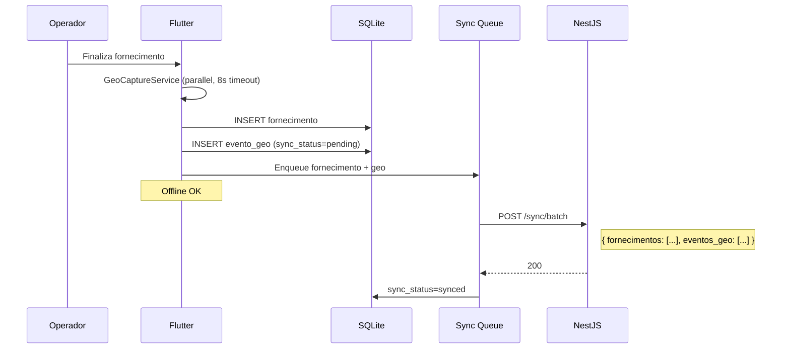

# Fase 7 — Estratégia de Geolocalização

Requisito **novo** do RFeed Lite: registrar geolocalização nos marcos operacionais de fabricação e fornecimento.

> No RFeed atual existe `POST /Post/GpsTrack` (trilha contínua), mas **não** geo nos momentos abrir/finalizar fab/forn.

---

## 7.1 Eventos geo obrigatórios

| Operação | Evento | Quando capturar |
|----------|--------|-----------------|
| **Fabricação** | `FABRICACAO_INICIO` | Ao criar/abrir batida (primeiro ingrediente ou confirmação kg) |
| **Fabricação** | `FABRICACAO_FIM` | Ao finalizar batida |
| **Fornecimento** | `FORNECIMENTO_INICIO` | Ao abrir entrega no curral (`abrir()` / peso início) |
| **Fornecimento** | `FORNECIMENTO_FIM` | Ao finalizar entrega no curral (`salvarFinalizado`) |

---

## 7.2 Modelo de dados

Tabela `evento_geo` (ver `database/database_model.md`):

| Campo | Tipo | Descrição |
|-------|------|-----------|
| `id` | UUID PK | |
| `tenant_id` | UUID FK | |
| `tipo` | ENUM | `FABRICACAO_INICIO`, `FABRICACAO_FIM`, `FORNECIMENTO_INICIO`, `FORNECIMENTO_FIM` |
| `referencia_tipo` | VARCHAR | `fabricacao` ou `fornecimento` |
| `referencia_id` | UUID | ID local ou server |
| `latitude` | DECIMAL(10,7) | WGS84 |
| `longitude` | DECIMAL(10,7) | WGS84 |
| `accuracy` | DECIMAL(8,2) | Metros (GPS) |
| `altitude` | DECIMAL(8,2) | Opcional |
| `timestamp` | TIMESTAMPTZ | Momento da captura |
| `device_id` | VARCHAR | ID do tablet |
| `sync_status` | VARCHAR | pending / synced |

### SQLite local (mobile)

```sql
CREATE TABLE evento_geo (
  id TEXT PRIMARY KEY,
  tenant_id TEXT NOT NULL,
  tipo TEXT NOT NULL,
  referencia_tipo TEXT NOT NULL,
  referencia_id TEXT NOT NULL,
  latitude REAL,
  longitude REAL,
  accuracy REAL,
  captured_at TEXT NOT NULL,
  sync_status TEXT DEFAULT 'pending'
);
CREATE INDEX idx_evento_geo_sync ON evento_geo(sync_status);
```

---

## 7.3 Captura no Flutter

### Dependência proposta

```yaml
dependencies:
  geolocator: ^13.0.0
```

### Serviço `GeoCaptureService`

```dart
class GeoCaptureService {
  Future<GeoPoint?> capture({Duration timeout = const Duration(seconds: 8)}) async {
    // 1. Verificar permissão (fine + coarse)
    // 2. Verificar GPS enabled
    // 3. getCurrentPosition(desiredAccuracy: high, timeLimit: timeout)
    // 4. Retornar GeoPoint ou null (não bloquear operação)
  }
}
```

### Integração nos fluxos (mapeamento RFeed → Lite)

| Ponto no RFeed atual | Arquivo | Ação Lite |
|----------------------|---------|-----------|
| Criar fabricação | `fabricacao_create_service.dart` | `capture()` → `FABRICACAO_INICIO` |
| Finalizar fabricação | `fabricacao_repo.dart` finalize | `capture()` → `FABRICACAO_FIM` |
| Abrir fornecimento curral | `fornecimento_dao.dart` `abrir()` | `capture()` → `FORNECIMENTO_INICIO` |
| Finalizar fornecimento | `fornecimento_dao.dart` `salvarFinalizado` | `capture()` → `FORNECIMENTO_FIM` |

### Regra: geo nunca bloqueia operação

```
Se GPS indisponível → registra operação SEM geo
Se accuracy > 100m → registra com flag baixa_precisao
Operador sempre consegue continuar
```

---

## 7.4 Estratégia offline



### Ordem de sync

1. Cadastros (download)
2. Fabricações (upload) + geo fab
3. Fornecimentos (upload) + geo forn
4. Eventos geo órfãos (retry)

Geo viaja **junto** com a operação no batch, mas também pode ser reenviado isoladamente.

---

## 7.5 API endpoints

| Método | Path | Descrição |
|--------|------|-----------|
| POST | `/api/v1/eventos-geo` | Registro unitário |
| POST | `/api/v1/sync/batch` | Inclui array `eventos_geo` |
| GET | `/api/v1/eventos-geo` | Filtro por fazenda, tipo, período |
| GET | `/api/v1/mapas/operacoes` | GeoJSON para Leaflet |

### Payload exemplo

```json
{
  "tipo": "FORNECIMENTO_FIM",
  "referencia_tipo": "fornecimento",
  "referencia_id": "a1b2c3d4-...",
  "latitude": -16.6799123,
  "longitude": -49.2550456,
  "accuracy": 12.5,
  "timestamp": "2026-06-09T14:32:01.000Z",
  "device_id": "tablet-001"
}
```

---

## 7.6 Visualização (Leaflet)

### Camadas do mapa web

| Camada | Fonte | Ícone |
|--------|-------|-------|
| Currais | `curral.latitude/longitude` | Pin permanente |
| Fab início | `evento_geo` FABRICACAO_INICIO | Verde ▶ |
| Fab fim | `evento_geo` FABRICACAO_FIM | Verde ■ |
| Forn início | `evento_geo` FORNECIMENTO_INICIO | Azul ▶ |
| Forn fim | `evento_geo` FORNECIMENTO_FIM | Azul ■ |

### GeoJSON endpoint

```
GET /api/v1/mapas/operacoes?fazenda_id=&data=2026-06-09
→ FeatureCollection com Point features
```

---

## 7.7 Relação com RFID

Quando RFID identifica curral **e** geo está disponível:

| Dado | Uso |
|------|-----|
| RFID EPC | Identifica curral (automático) |
| Geo | Valida proximidade ao curral cadastrado |
| Distância > 200m | Alerta no dashboard (não bloqueia) |

```sql
-- Validação opcional (dashboard)
SELECT c.nome,
       ST_Distance(
         ST_MakePoint(e.longitude, e.latitude)::geography,
         ST_MakePoint(c.longitude, c.latitude)::geography
       ) AS distancia_metros
FROM evento_geo e
JOIN fornecimento f ON f.id = e.referencia_id
JOIN curral c ON c.id = f.curral_id
WHERE e.tipo = 'FORNECIMENTO_INICIO';
```

Requer extensão PostGIS (opcional fase 2).

---

## 7.8 Permissões Android

```xml
<!-- AndroidManifest.xml Lite -->
<uses-permission android:name="android.permission.ACCESS_FINE_LOCATION" />
<uses-permission android:name="android.permission.ACCESS_COARSE_LOCATION" />
```

Diferente do RFeed atual (location só para WiFi SSID), Lite usa location para **GPS real**.

---

## 7.9 Riscos e mitigações

| Risco | Impacto | Mitigação |
|-------|---------|-----------|
| GPS impreciso em curral coberto | Geo errada | Registrar accuracy; alerta se > 100m |
| Sem sinal GPS | Sem geo | Operação continua; retry geo em background |
| Bateria | Consumo | Captura pontual (não trilha contínua) |
| Permissão negada | Sem geo | UX explicativa; modo manual |
| Sync geo atrasado | Mapa incompleto | Job retry independente |

---

## 7.10 Diferença vs RFeed GPS atual

| Aspecto | RFeed (GpsTrack) | RFeed Lite |
|---------|------------------|------------|
| Modelo | Trilha contínua (session + points) | Eventos discretos (4 tipos) |
| Persistência | next-api Postgres | NestJS Postgres direto |
| Cliente | Server-side accept | **geolocator** no tablet |
| Uso | Rota do caminhão | Prova de presença no curral/misturador |
| Offline | Envia batch de pontos | Outbox por evento |

Trilha contínua pode ser **fase 2** do Lite se necessário.
