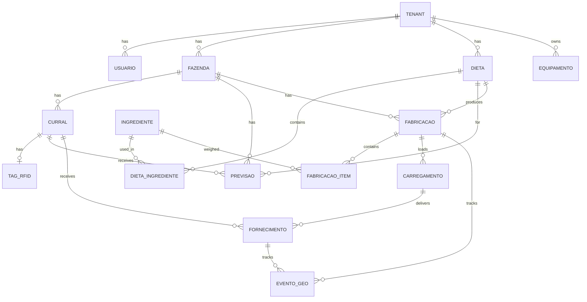

# Fase 6 — Modelo de Banco PostgreSQL

Schema proposto para o RFeed Lite. Todas as tabelas operacionais incluem `tenant_id`.

---

## 6.1 Diagrama ER (simplificado)



---

## 6.2 Tabelas

### tenant

| Coluna | Tipo | Constraints |
|--------|------|-------------|
| id | UUID | PK, DEFAULT gen_random_uuid() |
| nome | VARCHAR(200) | NOT NULL |
| slug | VARCHAR(100) | UNIQUE NOT NULL |
| ativo | BOOLEAN | DEFAULT true |
| settings | JSONB | DEFAULT '{}' |
| created_at | TIMESTAMPTZ | DEFAULT now() |
| updated_at | TIMESTAMPTZ | DEFAULT now() |

**Índices:** `UNIQUE(slug)`

**settings JSONB exemplo:**
```json
{
  "fornecimento_acumulativo": true,
  "ponto_corte_fornecimento_kg": 50,
  "ms_validacao_min": 0,
  "ms_validacao_max": 100
}
```

---

### usuario

| Coluna | Tipo | Constraints |
|--------|------|-------------|
| id | UUID | PK |
| tenant_id | UUID | FK → tenant(id), NOT NULL |
| nome | VARCHAR(200) | NOT NULL |
| email | VARCHAR(200) | NOT NULL |
| senha_hash | VARCHAR(255) | NOT NULL |
| cargo | VARCHAR(100) | |
| perfil | VARCHAR(50) | DEFAULT 'operador' — admin, operador, consulta |
| ativo | BOOLEAN | DEFAULT true |
| created_at | TIMESTAMPTZ | DEFAULT now() |

**Índices:** `UNIQUE(tenant_id, email)`, `INDEX(tenant_id, ativo)`

---

### fazenda

| Coluna | Tipo | Constraints |
|--------|------|-------------|
| id | UUID | PK |
| tenant_id | UUID | FK → tenant(id), NOT NULL |
| nome | VARCHAR(200) | NOT NULL |
| codigo | VARCHAR(50) | |
| ativo | BOOLEAN | DEFAULT true |
| created_at | TIMESTAMPTZ | DEFAULT now() |

**Índices:** `INDEX(tenant_id)`, `UNIQUE(tenant_id, codigo)`

---

### curral

| Coluna | Tipo | Constraints |
|--------|------|-------------|
| id | UUID | PK |
| tenant_id | UUID | FK → tenant(id), NOT NULL |
| fazenda_id | UUID | FK → fazenda(id), NOT NULL |
| nome | VARCHAR(200) | NOT NULL |
| linha | INTEGER | |
| ordem_trato | INTEGER | |
| latitude | DECIMAL(10,7) | |
| longitude | DECIMAL(10,7) | |
| ativo | BOOLEAN | DEFAULT true |
| created_at | TIMESTAMPTZ | DEFAULT now() |

**Índices:** `INDEX(tenant_id, fazenda_id)`, `INDEX(fazenda_id, ordem_trato)`

---

### tag_rfid

| Coluna | Tipo | Constraints |
|--------|------|-------------|
| id | UUID | PK |
| tenant_id | UUID | FK → tenant(id), NOT NULL |
| curral_id | UUID | FK → curral(id), NOT NULL |
| epc | VARCHAR(100) | NOT NULL |
| ativo | BOOLEAN | DEFAULT true |
| created_at | TIMESTAMPTZ | DEFAULT now() |

**Índices:** `UNIQUE(tenant_id, epc)`, `INDEX(curral_id)`

---

### dieta

| Coluna | Tipo | Constraints |
|--------|------|-------------|
| id | UUID | PK |
| tenant_id | UUID | FK → tenant(id), NOT NULL |
| fazenda_id | UUID | FK → fazenda(id) |
| nome | VARCHAR(200) | NOT NULL |
| ms_percent | DECIMAL(5,2) | CHECK (ms_percent > 0 AND ms_percent <= 100) |
| tipo | VARCHAR(50) | |
| ativo | BOOLEAN | DEFAULT true |
| created_at | TIMESTAMPTZ | DEFAULT now() |

**Índices:** `INDEX(tenant_id, fazenda_id)`

---

### ingrediente

| Coluna | Tipo | Constraints |
|--------|------|-------------|
| id | UUID | PK |
| tenant_id | UUID | FK → tenant(id), NOT NULL |
| nome | VARCHAR(200) | NOT NULL |
| ms_percent | DECIMAL(5,2) | |
| ativo | BOOLEAN | DEFAULT true |
| created_at | TIMESTAMPTZ | DEFAULT now() |

**Índices:** `INDEX(tenant_id)`

---

### dieta_ingrediente

| Coluna | Tipo | Constraints |
|--------|------|-------------|
| id | UUID | PK |
| tenant_id | UUID | FK → tenant(id), NOT NULL |
| dieta_id | UUID | FK → dieta(id), NOT NULL |
| ingrediente_id | UUID | FK → ingrediente(id), NOT NULL |
| mn_percent | DECIMAL(5,2) | NOT NULL — % na mistura |
| ordem | INTEGER | NOT NULL |
| pre_pesado | BOOLEAN | DEFAULT false |
| ms_inclusao | DECIMAL(5,2) | |

**Índices:** `UNIQUE(dieta_id, ingrediente_id)`, `INDEX(dieta_id, ordem)`

---

### previsao

| Coluna | Tipo | Constraints |
|--------|------|-------------|
| id | UUID | PK |
| tenant_id | UUID | FK → tenant(id), NOT NULL |
| fazenda_id | UUID | FK → fazenda(id), NOT NULL |
| curral_id | UUID | FK → curral(id), NOT NULL |
| dieta_id | UUID | FK → dieta(id), NOT NULL |
| data | DATE | NOT NULL |
| trato | INTEGER | NOT NULL |
| previsto_kg | DECIMAL(12,3) | NOT NULL DEFAULT 0 |
| realizado_kg | DECIMAL(12,3) | NOT NULL DEFAULT 0 |
| created_at | TIMESTAMPTZ | DEFAULT now() |
| updated_at | TIMESTAMPTZ | DEFAULT now() |

**Índices:**
- `UNIQUE(tenant_id, curral_id, dieta_id, data, trato)`
- `INDEX(tenant_id, fazenda_id, data)`
- `INDEX(data, trato)`

---

### fabricacao

| Coluna | Tipo | Constraints |
|--------|------|-------------|
| id | UUID | PK |
| tenant_id | UUID | FK → tenant(id), NOT NULL |
| fazenda_id | UUID | FK → fazenda(id), NOT NULL |
| dieta_id | UUID | FK → dieta(id), NOT NULL |
| trato | INTEGER | NOT NULL |
| data | DATE | NOT NULL |
| qtd_prevista_kg | DECIMAL(12,3) | DEFAULT 0 |
| qtd_realizada_kg | DECIMAL(12,3) | DEFAULT 0 |
| ms_prevista | DECIMAL(5,2) | |
| ms_realizada | DECIMAL(5,2) | |
| hora_inicio | TIMESTAMPTZ | |
| hora_fim | TIMESTAMPTZ | |
| status | VARCHAR(30) | DEFAULT 'em_andamento' — em_andamento, finalizada, cancelada |
| operador_id | UUID | FK → usuario(id) |
| equipamento_id | UUID | FK → equipamento(id) |
| device_id | VARCHAR(100) | |
| idempotency_key | VARCHAR(100) | UNIQUE |
| created_at | TIMESTAMPTZ | DEFAULT now() |
| updated_at | TIMESTAMPTZ | DEFAULT now() |

**Índices:** `INDEX(tenant_id, fazenda_id, data)`, `INDEX(status)`, `UNIQUE(idempotency_key)`

---

### fabricacao_item

| Coluna | Tipo | Constraints |
|--------|------|-------------|
| id | UUID | PK |
| tenant_id | UUID | FK → tenant(id), NOT NULL |
| fabricacao_id | UUID | FK → fabricacao(id) ON DELETE CASCADE, NOT NULL |
| ingrediente_id | UUID | FK → ingrediente(id), NOT NULL |
| ordem | INTEGER | NOT NULL |
| qtd_prevista_kg | DECIMAL(12,3) | DEFAULT 0 |
| qtd_realizada_kg | DECIMAL(12,3) | DEFAULT 0 |
| ms_insumo | DECIMAL(5,2) | |
| hora_inicio | TIMESTAMPTZ | |
| hora_fim | TIMESTAMPTZ | |
| pre_pesado | BOOLEAN | DEFAULT false |

**Índices:** `INDEX(fabricacao_id, ordem)`, `UNIQUE(fabricacao_id, ingrediente_id)`

---

### carregamento

| Coluna | Tipo | Constraints |
|--------|------|-------------|
| id | UUID | PK |
| tenant_id | UUID | FK → tenant(id), NOT NULL |
| fabricacao_id | UUID | FK → fabricacao(id), NOT NULL |
| dieta_id | UUID | FK → dieta(id), NOT NULL |
| peso_fabricado_kg | DECIMAL(12,3) | DEFAULT 0 |
| peso_carregado_kg | DECIMAL(12,3) | DEFAULT 0 |
| equipamento_id | UUID | FK → equipamento(id) |
| status | VARCHAR(30) | DEFAULT 'aberto' — aberto, finalizado |
| data_registro | TIMESTAMPTZ | DEFAULT now() |

**Índices:** `INDEX(tenant_id, status)`, `INDEX(fabricacao_id)`

---

### fornecimento

| Coluna | Tipo | Constraints |
|--------|------|-------------|
| id | UUID | PK |
| tenant_id | UUID | FK → tenant(id), NOT NULL |
| carregamento_id | UUID | FK → carregamento(id) |
| fabricacao_id | UUID | FK → fabricacao(id), NOT NULL |
| curral_id | UUID | FK → curral(id), NOT NULL |
| dieta_id | UUID | FK → dieta(id), NOT NULL |
| trato | INTEGER | NOT NULL |
| data | DATE | NOT NULL |
| previsto_kg | DECIMAL(12,3) | DEFAULT 0 |
| realizado_kg | DECIMAL(12,3) | DEFAULT 0 |
| peso_inicio_kg | DECIMAL(12,3) | |
| peso_fim_kg | DECIMAL(12,3) | |
| ms_realizada | DECIMAL(5,2) | |
| hora_inicio | TIMESTAMPTZ | |
| hora_fim | TIMESTAMPTZ | |
| operador_id | UUID | FK → usuario(id) |
| origem | VARCHAR(20) | DEFAULT 'manual' — manual, rfid, mapa |
| device_id | VARCHAR(100) | |
| idempotency_key | VARCHAR(100) | UNIQUE |
| created_at | TIMESTAMPTZ | DEFAULT now() |

**Índices:**
- `UNIQUE(tenant_id, curral_id, dieta_id, data, trato)` — chave natural (como CG Pec)
- `INDEX(tenant_id, data, trato)`
- `INDEX(carregamento_id)`
- `UNIQUE(idempotency_key)`

---

### evento_geo

| Coluna | Tipo | Constraints |
|--------|------|-------------|
| id | UUID | PK |
| tenant_id | UUID | FK → tenant(id), NOT NULL |
| tipo | VARCHAR(30) | NOT NULL — FABRICACAO_INICIO, FABRICACAO_FIM, FORNECIMENTO_INICIO, FORNECIMENTO_FIM |
| referencia_tipo | VARCHAR(30) | NOT NULL — fabricacao, fornecimento |
| referencia_id | UUID | NOT NULL |
| latitude | DECIMAL(10,7) | |
| longitude | DECIMAL(10,7) | |
| accuracy | DECIMAL(8,2) | |
| altitude | DECIMAL(8,2) | |
| captured_at | TIMESTAMPTZ | NOT NULL |
| device_id | VARCHAR(100) | |
| created_at | TIMESTAMPTZ | DEFAULT now() |

**Índices:**
- `INDEX(tenant_id, tipo, captured_at)`
- `INDEX(referencia_tipo, referencia_id)`
- `INDEX(tenant_id, captured_at DESC)`

---

### equipamento

| Coluna | Tipo | Constraints |
|--------|------|-------------|
| id | UUID | PK |
| tenant_id | UUID | FK → tenant(id), NOT NULL |
| fazenda_id | UUID | FK → fazenda(id) |
| nome | VARCHAR(200) | NOT NULL |
| tipo | VARCHAR(50) | — vagao, misturador, caminhao |
| capacidade_kg | DECIMAL(12,3) | |
| ativo | BOOLEAN | DEFAULT true |
| created_at | TIMESTAMPTZ | DEFAULT now() |

**Índices:** `INDEX(tenant_id, fazenda_id)`

---

## 6.3 Tabelas auxiliares

### sync_log (auditoria sync mobile)

| Coluna | Tipo |
|--------|------|
| id | UUID PK |
| tenant_id | UUID FK |
| device_id | VARCHAR(100) |
| direction | VARCHAR(10) — up, down |
| entity_type | VARCHAR(50) |
| entity_id | UUID |
| status | VARCHAR(20) |
| payload | JSONB |
| created_at | TIMESTAMPTZ |

### audit_log (ações web/API)

| Coluna | Tipo |
|--------|------|
| id | UUID PK |
| tenant_id | UUID FK |
| user_id | UUID FK |
| action | VARCHAR(100) |
| entity_type | VARCHAR(50) |
| entity_id | UUID |
| metadata | JSONB |
| created_at | TIMESTAMPTZ |

---

## 6.4 Row Level Security

```sql
ALTER TABLE curral ENABLE ROW LEVEL SECURITY;

CREATE POLICY tenant_isolation ON curral
  USING (tenant_id = current_setting('app.current_tenant')::uuid);

-- Repetir para todas as tabelas operacionais
```

---

## 6.5 Mapeamento RFeed SQLite → Lite PostgreSQL

| RFeed SQLite | Lite PostgreSQL |
|--------------|-----------------|
| `CADASTRO_FAZENDAS` | `fazenda` |
| `CADASTRO_USUARIO` | `usuario` |
| `DETALHES_BAIAS` | `curral` + `tag_rfid` |
| `DIETA` | `dieta` |
| `DETALHES_DIETAS` | `dieta_ingrediente` + `ingrediente` |
| `PREVISAO` | `previsao` |
| `CADASTRO_FABRICA_RACAO` | `fabricacao` |
| `DETALHES_FABRICA_RACAO` | `fabricacao_item` |
| `CARREGAMENTO` | `carregamento` |
| `CADASTRO_FORNECIMENTO` | `fornecimento` |
| *(novo)* | `evento_geo` |
| `VAGAO` | `equipamento` |
| `CONFIG` | `device_profile` local + `tenant.settings` |
| `GRAVA_TAG` | `tag_rfid` |

---

## 6.6 SQLite mobile (espelho simplificado)

O tablet mantém subset offline:

- `tenant_config`, `usuario` (cache), `fazenda`, `curral`, `tag_rfid`
- `dieta`, `dieta_ingrediente`, `ingrediente`
- `previsao` (dia corrente + buffer)
- `fabricacao`, `fabricacao_item`
- `carregamento`, `fornecimento`
- `evento_geo`
- `sync_queue` (outbox genérico)

Campo universal: `sync_status TEXT DEFAULT 'pending'`, `server_id TEXT`.

---

## 6.7 Índices de performance

```sql
-- Dashboard previsto vs realizado
CREATE INDEX idx_previsao_dashboard
  ON previsao (tenant_id, fazenda_id, data, trato);

-- Sync mobile pending
CREATE INDEX idx_fabricacao_pending
  ON fabricacao (tenant_id, status)
  WHERE status = 'em_andamento';

-- Mapa geo do dia
CREATE INDEX idx_evento_geo_dia
  ON evento_geo (tenant_id, captured_at)
  WHERE latitude IS NOT NULL;
```

---

## 6.8 Extensões PostgreSQL recomendadas

| Extensão | Uso | Fase |
|----------|-----|------|
| `uuid-ossp` ou `pgcrypto` | UUID generation | MVP |
| `pg_trgm` | Busca texto currais/dietas | MVP |
| `postgis` | Distância geo curral vs evento | Fase 2 |
