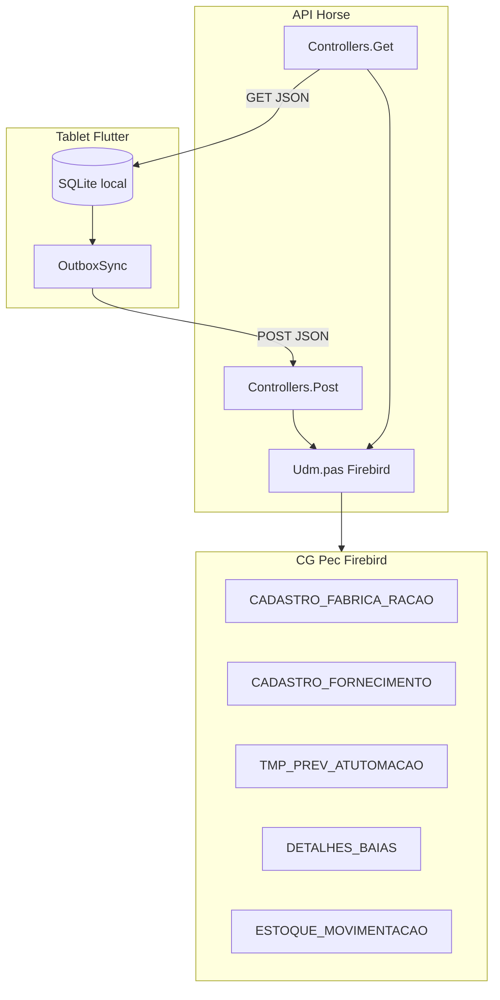

# Fase 2 — Dependências do CG Pec

Mapeamento de tudo que acopla o RFeed ao **CG Pec (Firebird)** e que deve ser **desacoplado** no RFeed Lite.

---

## 2.1 Visão geral do acoplamento



No **RFeed Lite**, o Firebird desaparece. NestJS persiste direto no PostgreSQL.

---

## 2.2 Endpoints acoplados ao CG Pec

| Endpoint Horse | Acoplamento | Ação Lite |
|----------------|-------------|-----------|
| `GET /usuarios/get/:idfazenda` | `CADASTRO_USUARIO` Firebird | `GET /api/v1/usuarios` (JWT + tenant) |
| `GET /dietas/get/:idfazenda` | `CADASTRO_DIETAS` | `GET /api/v1/dietas` |
| `GET /dietasdetalhes/get/:idfazenda` | `DETALHES_DIETAS` + `CADASTRO_INSUMOS` | `GET /api/v1/dietas/:id/ingredientes` |
| `GET /baias/get/:idfazenda` | `DETALHES_BAIAS` + RFID | `GET /api/v1/currais` |
| `GET /previsaotrato/get/:idfazenda/:data` | `TMP_PREV_ATUTOMACAO` + MS complexo | `GET /api/v1/previsoes?data=` |
| `GET /fazenda/get` | `CADASTRO_FAZENDA` | `GET /api/v1/fazendas` |
| `GET /vagao/get` | `CADASTRO_INSUMOS` (vagão) | `GET /api/v1/equipamentos` |
| `POST /Post/Fabricacao` | `CADASTRO_FABRICA_RACAO` + MS cascade | `POST /api/v1/fabricacoes` |
| `POST /Post/Fabricacao_Insumo` | `DETALHES_FABRICA_RACAO` + `ESTOQUE_MOVIMENTACAO` | `POST /api/v1/fabricacoes/:id/itens` |
| `POST /Post/Fornecimento` | `CADASTRO_FORNECIMENTO` + acumulativo + ponto corte | `POST /api/v1/fornecimentos` |
| `POST /Post/GravaTag` | `DETALHES_BAIAS.RFID` | `PUT /api/v1/currais/:id/tag` |
| `GET /dashboard/fabricacao/*` | Joins CG Pec | `GET /api/v1/dashboard/*` (Postgres) |

**Manter como referência de contrato**, não como implementação.

---

## 2.3 Modelos / tabelas CG Pec usados pelo tablet

| Tabela SQLite (tablet) | Origem CG Pec | Campo problemático |
|------------------------|---------------|-------------------|
| `CADASTRO_FABRICA_RACAO` | Sync POST + local | `ID` UUID local ≠ ID CG Pec |
| `DETALHES_FABRICA_RACAO` | Ingredientes | `MN_PERC`, `PRE_PESADO` — regra CG |
| `CADASTRO_FORNECIMENTO` | POST fornecimento | Chave natural baia+trato+data+dieta |
| `PREVISAO` | GET previsão trato | `TMP_PREV_ATUTOMACAO` MS último trato |
| `DETALHES_BAIAS` | GET baias | `ID_PASTO_CURRAL`, `RFID` |
| `DIETA` | GET dietas | `MS` da dieta CG |
| `DETALHES_DIETAS` | GET detalhes | `MN_PERCENT` 1..100 |
| `CADASTRO_USUARIO` | GET usuarios | Senha em texto no SQLite local |
| `CONFIG` | Local | `BACKEND=0/1` CG vs Field |

---

## 2.4 Regras de negócio exclusivas CG Pec

### 4.1 MS (Matéria Seca)

| Regra | Onde | Lite |
|-------|------|------|
| MS fornecimento = MS_BATIDA da fabricação | `Controllers.Post.pas` → `ResolveMsFornecimento` | Manter lógica; MS vem do Postgres Lite |
| MS insumo de `DETALHES_DIETAS` | `ResolveMsInsumoCgPec` | Tabela `ingrediente` + `dieta_ingrediente` |
| MS 0–100 validação | `lib/utils/ms_percent.dart` | **Reutilizar** |
| `EnsureCgPecFabricacaoMsValores` | Recalcula header da fab | Trigger ou service NestJS |

### 4.2 Fornecimento acumulativo

```pascal
// ApiConfig.ini [API] FornecimentoAcumulativo=1
REALIZADO = COALESCE(REALIZADO,0) + :REAL
```

**Lite:** config por tenant `fornecimento_acumulativo: boolean`. Mesma semântica.

### 4.3 Ponto de corte

```pascal
// PontoCorteFornecimentoKg=50
// Se realizado <= corte → não grava, retorna 200 ignorado
```

**Lite:** `tenant.ponto_corte_fornecimento_kg`. Endpoint confirma sync sem persistir.

### 4.4 Previsão — último trato MS

`GeraTabelaTMP_Previsao` popula temp table com ajuste MS no último trato do dia.

**Lite:** calcular no NestJS ou aceitar previsão importada (Excel/API) sem TMP table.

### 4.5 Chave natural fornecimento

```
ID_BAIA + TRATO + DATA + ID_DIETA → UPDATE ou INSERT
```

**Lite:** `UNIQUE (tenant_id, curral_id, trato, data, dieta_id)` no Postgres.

### 4.6 Estoque / custo médio (fabricação insumo)

`GetCustoMedioKgInsumo` → `ESTOQUE_MOVIMENTACAO`.

**Lite MVP:** **fora de escopo**. Lite não gerencia estoque CG Pec. Registrar apenas kg realizados.

### 4.7 AtualizaResumoFabricacao

Recalcula `MS_BATIDA`, `QTDE_REALIZADA`, `CUSTO_KG_DIETA` no header.

**Lite:** service `FabricacaoService.recalcularTotais(id)`.

---

## 2.5 Integrações Firebird no código

| Arquivo | Dependência Firebird |
|---------|---------------------|
| `api_horse/CGPec/Source/dm/Udm.pas` | Connection, queries, `AtualizaDB`, `GeraTabelaTMP_Previsao` |
| `api_horse/CGPec/Source/Controllers/Controllers.Get.pas` | Todos os GETs |
| `api_horse/CGPec/Source/Controllers/Controllers.Post.pas` | Todos os POSTs |
| `api_horse/FieldPec/Source/dm/UdmFieldPec.pas` | Variante Field (stubs) |
| `api_horse/CGPec/Source/BiMirror/UBiMirror.pas` | Espelho para next-api (não Firebird direto) |

**Nenhum destes arquivos entra no Lite.**

---

## 2.6 Dependências no Flutter acopladas ao CG Pec

| Arquivo | Acoplamento | Desacoplamento |
|---------|-------------|----------------|
| `lib/services/api_service.dart` | URLs Horse, paths CG Pec, backend 0/1 | Novo `LiteApiClient` NestJS |
| `lib/services/outbox_sync.dart` | Payload POST Horse, MS resolve server-side | Payload REST Lite + idempotency key |
| `lib/services/bootstrap_sync.dart` | Mapeamento JSON Horse → SQLite CG schema | Sync Lite schema |
| `lib/features/fabricacao/data/fabricacao_repo.dart` | Nomes colunas CG Pec | Repository Lite |
| `lib/features/fornecimento/data/fornecimento_tables.dart` | SQL helpers CG | Query builders Lite |
| `lib/repo/config_repo.dart` | `BACKEND`, `TIPO_TRABALHO`, estacionário | Config SaaS URL + tenant slug |
| `lib/features/estacionario/*` | Fluxo handoff CG Pec | **Remover** |
| `lib/helpers/mirror_service.dart` | Espelho PA | **Remover** |

---

## 2.7 Configuração ApiConfig.ini → Lite

| Chave CG Pec | Equivalente Lite |
|--------------|------------------|
| `[CGPEC] Server/DB` | PostgreSQL connection string (env) |
| `[API] ActiveClient` | Removido (só Lite) |
| `[API] FornecimentoAcumulativo` | `tenant_settings.fornecimento_acumulativo` |
| `[API] PontoCorteFornecimentoKg` | `tenant_settings.ponto_corte_kg` |
| `[MIRROR] NextApiBase` | Removido (NestJS é a API) |
| `[POSTGRES]` | Banco principal (não espelho) |

---

## 2.8 Matriz de desacoplamento

| Componente | Esforço | Prioridade | Risco |
|------------|---------|------------|-------|
| Substituir Firebird por Postgres | Alto | P0 | Médio — schema novo |
| Portar regras MS/acumulativo/corte | Médio | P0 | Baixo — bem documentado |
| Novo sync protocol (JWT) | Alto | P0 | Médio — offline queue |
| Remover estacionário/mirror | Baixo | P1 | Baixo |
| Previsão sem TMP table | Médio | P1 | Médio — validar com negócio |
| Estoque/custo insumo | N/A | P3 | Fora MVP |
| Dashboard CG joins | Médio | P2 | Baixo — Postgres views |

---

## 2.9 Checklist de desacoplamento

- [ ] Nenhuma referência a `CADASTRO_*` CG Pec no Lite mobile
- [ ] Nenhuma conexão Firebird no Lite backend
- [ ] `tenant_id` em 100% das entidades operacionais
- [ ] MS calculada no Lite backend (não no Firebird)
- [ ] Previsão importável via Excel/API (não depende de `TMP_PREV_ATUTOMACAO`)
- [ ] IDs UUID gerados no Lite (sem mapeamento ID CG Pec)
- [ ] Auth JWT (sem senha em SQLite local)
- [ ] Feature flags: balança, RFID, manual — por dispositivo/tenant

---

## 2.10 Compatibilidade futura (opcional)

Para clientes que usam **RFeed + CG Pec** e **RFeed Lite** na mesma operação:

| Integração | Direção | Mecanismo |
|------------|---------|-----------|
| Lite → CG Pec | Export | Conector batch (fase 3+) |
| CG Pec → Lite | Import | API + mapeamento de IDs |
| Coexistência | — | Produtos separados, dados sincronizados via ETL |

**MVP Lite não exige integração com CG Pec.**
