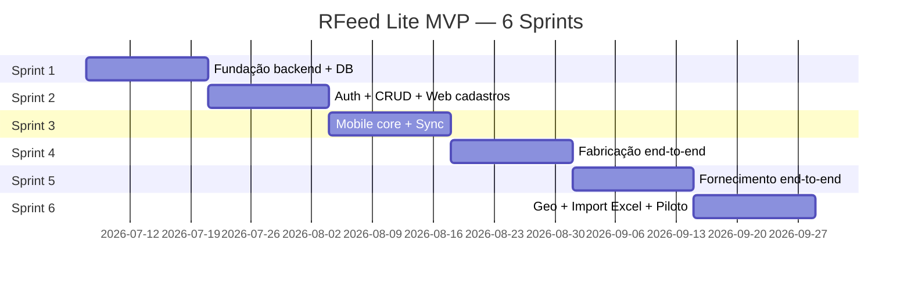

# Fase 9 — Plano de Migração (Roadmap)

Roadmap técnico em 6 sprints (~12 semanas) para MVP do RFeed Lite.

**Equipe sugerida:** 2 devs Flutter, 2 devs backend (NestJS), 1 dev frontend web, 1 QA, 0.5 DevOps.

---

## Visão geral

---

## Sprint 1 — Fundação (semanas 1–2)

### Entregáveis

- [ ] Monorepo `rfeed-lite/` scaffold (mobile, backend, web, docker)
- [ ] NestJS project + PostgreSQL docker-compose
- [ ] Migrations: `tenant`, `usuario`, `fazenda`, `curral`, `dieta`, `ingrediente`
- [ ] Pacote Dart `packages/hardware/` com `scale_comm.dart` + `rfid_comm.dart` copiados
- [ ] CI básico (lint + build)
- [ ] README setup desenvolvimento

### Dependências

- Nenhuma (início greenfield)

### Riscos

| Risco | Impacto | Mitigação |
|-------|---------|-----------|
| Definição multi-tenant incompleta | Alto | Validar RLS cedo com 2 tenants teste |
| Docker on-premise Windows | Médio | Testar docker-compose Win Server |

### Critério de done

- `docker-compose up` sobe API + Postgres
- Migration roda clean
- ScaleComm conecta balança de teste

---

## Sprint 2 — Auth + Cadastros Web (semanas 3–4)

### Entregáveis

- [ ] JWT auth (login, refresh, guards)
- [ ] CRUD API: usuarios, fazendas, currais, dietas, ingredientes, equipamentos
- [ ] RLS PostgreSQL ativo
- [ ] Web backoffice: login + CRUD fazenda/curral/dieta (Next.js)
- [ ] Seed script com tenant demo
- [ ] OpenAPI Swagger UI em `/api/docs`

### Dependências

- Sprint 1 (schema + NestJS)

### Riscos

| Risco | Impacto | Mitigação |
|-------|---------|-----------|
| UX web atrasada | Médio | Priorizar CRUD mínimo; polish depois |
| Permissões perfil | Baixo | 3 perfis fixos MVP: admin, operador, consulta |

### Critério de done

- Admin cria fazenda + 20 currais + dieta via web
- JWT funciona no Swagger

---

## Sprint 3 — Mobile Core + Sync (semanas 5–6)

### Entregáveis

- [ ] Flutter Lite app scaffold (core/, features/, shared/)
- [ ] SQLite schema mobile + migrations
- [ ] `ApiClient` Dio + JWT refresh
- [ ] `SyncOrchestrator`: bootstrap download + batch upload
- [ ] Telas: config, login, sync, menu
- [ ] API endpoints: `/sync/bootstrap`, `/sync/batch`
- [ ] Teste offline: login → sync download → modo avião

### Dependências

- Sprint 2 (API cadastros + auth)

### Riscos

| Risco | Impacto | Mitigação |
|-------|---------|-----------|
| Conflito sync | Alto | Idempotency key desde sprint 3 |
| Schema drift mobile/server | Médio | Version field em bootstrap |

### Critério de done

- Tablet baixa currais/dietas/previsão offline
- Reconecta e confirma sync OK

---

## Sprint 4 — Fabricação (semanas 7–8)

### Entregáveis

- [ ] API: `/fabricacoes`, `/fabricacoes/:id/itens`, `/finalizar`
- [ ] Portar UI: lista, nova (prefab), pesagem, timer mistura
- [ ] Portar `FabricacaoController` (loop ingredientes + balança)
- [ ] Modo manual (input kg) + modo balança TCP
- [ ] MS calculada server-side
- [ ] Sync upload fabricação + itens
- [ ] Geo: `FABRICACAO_INICIO` + `FABRICACAO_FIM`

### Dependências

- Sprint 3 (mobile core + sync)
- Sprint 2 (dietas com ingredientes cadastrados)

### Riscos

| Risco | Impacto | Mitigação |
|-------|---------|-----------|
| Loop pesagem complexo | Alto | Testar com 1 dieta 8 ingredientes reais |
| MS divergente RFeed vs Lite | Médio | Comparar com casos RFeed documentados |

### Critério de done

- Operador fabrica batida completa offline → sync → visível no web

---

## Sprint 5 — Fornecimento (semanas 9–10)

### Entregáveis

- [ ] API: `/fornecimentos`, `/carregamentos`, acumulativo + ponto corte
- [ ] Portar UI: lista, pré, pesagem, dashboard mapa
- [ ] Portar `FornecimentoController` (histerese + RFID + balança)
- [ ] Modo manual (seleção curral) + RFID + balança
- [ ] Grava tag RFID (web + mobile)
- [ ] Geo: `FORNECIMENTO_INICIO` + `FORNECIMENTO_FIM`
- [ ] Dashboard web: previsto vs realizado

### Dependências

- Sprint 4 (fabricação gera carregamento)
- Sprint 2 (previsão cadastrada)

### Riscos

| Risco | Impacto | Mitigação |
|-------|---------|-----------|
| Mapa scroll (bug RFeed) | Baixo | Portar fix já feito no RFeed |
| Acumulativo incorreto | Alto | Testes com 3 entregas mesmo curral |
| RFID tag duplicada | Médio | Unique constraint + UX erro |

### Critério de done

- Fluxo completo: fabricar → carregar → fornecer 5 currais → sync → dashboard

---

## Sprint 6 — Integrações + Piloto (semanas 11–12)

### Entregáveis

- [ ] Import Excel previsão (web upload + BullMQ)
- [ ] API Key para integração externa
- [ ] Mapa Leaflet: currais + eventos geo
- [ ] Webhook `fabricacao.finalizada`, `fornecimento.registrado`
- [ ] Docker on-premise package
- [ ] Documentação operador
- [ ] Piloto em 1 fazenda (manual + balança + RFID)
- [ ] APK Lite release

### Dependências

- Sprints 4–5 (fluxos operacionais completos)

### Riscos

| Risco | Impacto | Mitigação |
|-------|---------|-----------|
| Excel formatos variados | Médio | Template fixo + validação linha a linha |
| Piloto bloqueado por GPS | Médio | Geo opcional (não bloqueia) |
| Performance import 10k linhas | Baixo | Job async + progress web |

### Critério de done (MVP)

- [ ] 1 fazenda piloto operando 1 semana
- [ ] Import Excel previsão funcional
- [ ] Mapa com eventos geo do dia
- [ ] Zero dependência CG Pec
- [ ] Deploy SaaS + on-premise documentado

---

## Resumo por sprint

| Sprint | Foco | Entregável principal | Risco principal |
|--------|------|---------------------|-----------------|
| **1** | Fundação | Docker + DB + hardware package | Multi-tenant RLS |
| **2** | Auth + Web CRUD | Backoffice cadastros | Permissões |
| **3** | Mobile + Sync | Offline bootstrap | Conflito sync |
| **4** | Fabricação | Batida completa E2E | Loop pesagem |
| **5** | Fornecimento | Entrega curral E2E | Acumulativo |
| **6** | Integrações | Excel + mapa + piloto | Formato Excel |

---

## Pós-MVP (roadmap fase 2)

| Item | Sprint estimada |
|------|-----------------|
| PostGIS validação proximidade curral | +1 sprint |
| Trilha GPS contínua (opcional) | +2 sprints |
| Conector export CG Pec | +2 sprints |
| BI avançado (fl_chart web) | +1 sprint |
| App iOS | +2 sprints |
| Estoque insumos Lite | +3 sprints |
| White-label SaaS | +2 sprints |

---

## Estimativa de esforço total MVP

| Módulo | Horas | Sprints |
|--------|-------|---------|
| Backend NestJS | 320h | 1–6 |
| PostgreSQL + migrations | 80h | 1–2 |
| Flutter mobile | 400h | 3–5 |
| Web backoffice | 200h | 2, 5–6 |
| Hardware (scale/RFID) | 40h | 1, 4–5 |
| Geo | 60h | 4–6 |
| QA + piloto | 120h | 5–6 |
| DevOps | 60h | 1, 6 |
| **Total** | **~1280h** | **6 sprints** |

Com equipe de 5 devs: **~12 semanas** (realista).  
Com equipe de 3 devs: **~18–20 semanas**.

---

## Dependências externas

| Dependência | Responsável | Quando |
|-------------|-------------|--------|
| Servidor/cloud SaaS | DevOps/RSistemas | Sprint 1 |
| Tablet Android teste | Operação | Sprint 3 |
| Balança + RFID campo | Cliente piloto | Sprint 4 |
| Template Excel validado | Produto/negócio | Sprint 6 |
| Fazenda piloto | Comercial | Sprint 6 |

---

## Gate de qualidade pré-piloto

- [ ] 100% endpoints MVP com teste automatizado
- [ ] Sync offline 8h simulado sem perda
- [ ] Pentest básico auth/RLS
- [ ] APK assinado + deploy backend staging
- [ ] Rollback plan documentado
- [ ] RFeed produção **não afetado** (repos separados)
