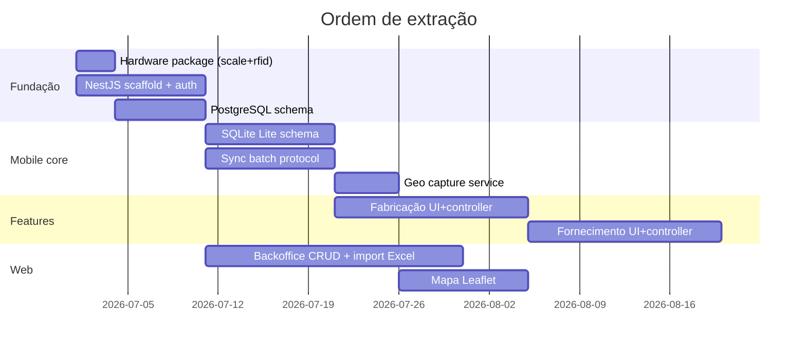

# Fase 5 — Extração de Módulos

Plano de migração módulo a módulo do RFeed para o RFeed Lite.

---

## 5.1 Resumo por módulo

| Módulo | Reaproveitamento | Esforço | Prioridade MVP |
|--------|------------------|---------|----------------|
| Balança (ScaleComm) | 95% | **Baixo** (1–2 dias) | P1 |
| RFID (RfidComm) | 95% | **Baixo** (1–2 dias) | P1 |
| SQLite / offline | 35% | **Alto** (2–3 semanas) | P0 |
| Sync (outbox) | 50% | **Alto** (2 semanas) | P0 |
| GPS / Geo | 10% | **Médio** (1 semana) | P0 |
| Fabricação | 55% | **Alto** (3 semanas) | P0 |
| Fornecimento | 60% | **Alto** (3 semanas) | P0 |
| Estacionário / PA | 0% | N/A | **Excluir** |

---

## 5.2 Módulo: Balança TCP

### Origem RFeed

| Arquivo | Linhas ~ | Função |
|---------|----------|--------|
| `lib/helpers/scale_comm.dart` | 470 | TCP client, parsers Topcom/DG500/Alfa |
| `lib/features/fornecimento/services/scale_tcp_service.dart` | 80 | Stream wrapper |
| `lib/features/fornecimento/services/balanca_parser.dart` | 120 | Parse por modelo |
| `lib/widgets/scale_peso_highlight_card.dart` | 60 | UI peso ao vivo |

### Dependências

- `dart:io` (Socket TCP)
- Config: host, port, model
- **Sem** dependência CG Pec

### Riscos

| Risco | Probabilidade | Mitigação |
|-------|---------------|-----------|
| Modelo balança não documentado | Baixa | Já suporta Raw fallback |
| Reconnect em rede instável | Média | Já tem auto-reconnect |
| Thread UI | Baixa | Streams + debounce existentes |

### Esforço de migração: **1–2 dias**

1. Copiar arquivos para `packages/hardware/`
2. Remover imports RFeed-specific
3. Testar com balança real (Topcom)
4. Integrar no `FornecimentoController` Lite

### Ação: **Reutilizar sem alterações** (copiar)

---

## 5.3 Módulo: RFID TCP

### Origem RFeed

| Arquivo | Função |
|---------|--------|
| `lib/helpers/rfid_comm.dart` | TCP client, EPC events, debounce 700ms |
| `lib/features/fornecimento/services/rfid_tcp_service.dart` | Stream + `extractEpc()` |
| `lib/pages/grava_tag_page.dart` | UI associação tag |
| `lib/repo/grava_tag_repo.dart` | CRUD local tags |

### Dependências

- `DETALHES_BAIAS.RFID` → Lite: `curral.tag_rfid`
- TCP config host/port

### Riscos

| Risco | Mitigação |
|-------|-----------|
| Tag duplicada em 2 currais | Unique constraint `(tenant_id, epc)` |
| Leitura fantasma | Debounce já implementado |
| Curral não encontrado | Fallback seleção manual |

### Esforço: **2–3 dias**

### Ação: **Reutilizar com pequenas adaptações**

---

## 5.4 Módulo: SQLite / Offline

### Origem RFeed

| Arquivo | Função |
|---------|--------|
| `lib/db/app_db.dart` | Schema v9, migrations |
| Feature DAOs | Queries específicas |

### Dependências a remover

- Nomes tabelas CG Pec (`CADASTRO_*`, `DETALHES_*`)
- `CONFIG.BACKEND`, `TIPO_TRABALHO`, estacionário
- `FLAG_SYNC` → `sync_status` enum

### Novo schema Lite

Ver `database/database_model.md` — tabelas espelhadas com `tenant_id`.

### Riscos

| Risco | Mitigação |
|-------|-----------|
| Migration de dados RFeed→Lite | N/A — produtos separados |
| Schema drift mobile vs server | Versioned migrations both sides |
| Corrupção SQLite | Backup periódico (copiar `config_disk_backup` pattern) |

### Esforço: **2–3 semanas**

### Ação: **Reescrever schema; reutilizar padrão**

---

## 5.5 Módulo: Sync

### Origem RFeed

| Arquivo | Função |
|---------|--------|
| `lib/services/outbox_sync.dart` | Upload pending |
| `lib/services/bootstrap_sync.dart` | Download master |
| `lib/services/sync_orchestrator.dart` | Pipeline |
| `lib/pages/sync_page.dart` | UI progresso |

### Mudanças Lite

| RFeed | Lite |
|-------|------|
| POST Horse individual | POST `/sync/batch` NestJS |
| GET Horse por recurso | GET `/sync/bootstrap?since=` |
| Sem auth | JWT header |
| Decimal BR string | JSON number (normalizado) |
| Sem idempotency | `X-Idempotency-Key` |

### Riscos

| Risco | Mitigação |
|-------|-----------|
| Conflito de versão | Server wins cadastros; append acumulativo |
| Sync parcial (rede cai) | Transação por item; retry individual |
| Ordem fab→forn | Manter ordem do orchestrator |

### Esforço: **2 semanas**

### Ação: **Reutilizar padrão; reescrever protocolo**

---

## 5.6 Módulo: GPS / Geolocalização

### Origem RFeed

| Item | Status |
|------|--------|
| `POST /Post/GpsTrack` | Server-side only |
| `wifi_guard.dart` | Location for WiFi, not GPS |
| Flutter geolocator | **Ausente** |

### Lite (novo)

| Componente | Esforço |
|------------|---------|
| `GeoCaptureService` (geolocator) | 2 dias |
| Tabela `evento_geo` SQLite + Postgres | 1 dia |
| Integração 4 marcos fab/forn | 2 dias |
| Sync batch geo | 1 dia |
| Mapa Leaflet web | 3 dias |

### Riscos

| Risco | Mitigação |
|-------|-----------|
| GPS indisponível | Não bloquear operação |
| Precisão ruim | Campo `accuracy` + alerta dashboard |

### Esforço total: **1–1.5 semanas**

### Ação: **Reescrever (requisito novo)**

---

## 5.7 Módulo: Fabricação

### Origem RFeed

```
lib/features/fabricacao/
├── controller/fabricacao_controller.dart    # State machine pesagem
├── data/fabricacao_repo.dart                # SQL + MS calc
├── services/fabricacao_create_service.dart  # Cria batida + ingredientes
├── domain/fabricacao_flow.dart              # Status estacionário
└── ui/ (6 telas)
```

### Dependências

| Dep | Lite |
|-----|------|
| `DETALHES_DIETAS` → ingredientes | API `/dietas/:id/ingredientes` |
| `CADASTRO_FABRICA_RACAO` | Tabela `fabricacao` Postgres |
| Estacionário handoff | **Remover** |
| Mirror PA | **Remover** |
| MS cascade CG Pec | Service NestJS |
| ScaleComm | **Reutilizar** |

### Componentes migráveis

| Componente | % reuso |
|------------|---------|
| UI pesagem (`fabricacao_weigh_page`) | 70% |
| Controller loop ingredientes | 55% |
| Timer mistura | 90% |
| Create service (lógica ingredientes) | 50% |
| Repo SQL | 20% |

### Riscos

| Risco | Mitigação |
|-------|-----------|
| PRE_PESADO / MN_PERCENT | Manter campos; import via dieta |
| MS realizada incorreta | Portar `ms_percent.dart` + server calc |
| Ingredientes fora de ordem | Manter campo `ordem` |

### Esforço: **3 semanas**

### Ação: **Reutilizar UI/controller; reescrever data layer**

---

## 5.8 Módulo: Fornecimento

### Origem RFeed

```
lib/features/fornecimento/
├── controller/fornecimento_controller.dart
├── controller/fornecimento_dashboard_controller.dart
├── data/fornecimento_repo.dart, fornecimento_dao.dart
├── domain/histerese_params.dart, fornecimento_models.dart
└── ui/ (5 telas + widgets)
```

### Dependências

| Dep | Lite |
|-----|------|
| `PREVISAO` composite PK | Tabela `previsao` UUID PK |
| `CARREGAMENTO` | Tabela `carregamento` |
| Acumulativo server-side | Config tenant |
| Ponto corte | Config tenant |
| Histerese balança | **Reutilizar** `histerese_params.dart` |
| Mapa horizontal scroll | **Reutilizar** UI pattern |

### Componentes migráveis

| Componente | % reuso |
|------------|---------|
| Controller (scale+RFID+curral) | 60% |
| Dashboard mapa | 55% |
| Models (`CurralPrev`) | 50% |
| DAO SQL | 25% |
| Histerese | 85% |

### Riscos

| Risco | Mitigação |
|-------|-----------|
| Hora início = fim (bug corrigido RFeed) | Garantir `abrir()` ≠ `finalizar()` no Lite |
| Scroll mapa reset | Pattern já corrigido no RFeed — portar fix |
| MS do fornecimento | Resolver via fabricação no NestJS |

### Esforço: **3 semanas**

### Ação: **Reutilizar controller/UI; reescrever data layer**

---

## 5.9 Módulos excluídos

| Módulo | Motivo |
|--------|--------|
| `features/estacionario/` | Fluxo caminhão+estação — produto RFeed |
| `rfeed_pa/` | App pá carregadeira |
| `helpers/mirror_service.dart` | Espelho TCP JSON |
| `services/carregamento_bridge.dart` | Bridge estacionário |
| `services/wifi_guard.dart` | WiFi SSID para estacionário |
| API Horse inteira | Substituída por NestJS |
| BiMirror | Substituído por persistência direta |

---

## 5.10 Ordem recomendada de extração



---

## 5.11 Matriz dependências cruzadas

| Módulo | Depende de |
|--------|------------|
| Fabricação UI | SQLite, ScaleComm, Sync, Geo, API dietas |
| Fornecimento UI | SQLite, ScaleComm, RfidComm, Sync, Geo, API previsão |
| Sync | Auth JWT, API NestJS, SQLite |
| Geo | SQLite, Sync, permissões Android |
| Web mapa | API evento_geo, API currais |
| Import Excel | API NestJS, BullMQ, PostgreSQL |
